# Reading guide

This page says how to read each figure MemorY draws, on a terminal and in a report. The examples are the case in this repository, [examples/demo.mycase](../examples/README.md): a host with a row fault in `CPU0_C1` and one repeating cell in `CPU1_D1`. `my help reading` prints a short form of this page.

Every figure has one question it answers:

| Figure | Question | Command |
| --- | --- | --- |
| Slot map and ranking | which DIMM | `my` |
| Finding | what to do, and what it rests on | `my why <slot>` |
| Topology bars | which branch of the DIMM the errors sit on | `my dimm <slot>` |
| Address map | what kind of fault | `my map <slot>` |
| Timeline | is it growing, and did a repair help | `my timeline [slot]` |
| GPU memory | is there room left to repair | `my gpu` |

`my dimm <slot>` shows the finding, the bars, the map and the timeline of one DIMM together, and `my report` puts all of them into one document.

## Slot map and ranking

```
$ my open examples/demo.mycase
case bundle of 2026-11-13 09:30 UTC, written by my dev; subject CPU0_C1 S/N 3B9C56
host r12-n034  Example Systems R760  2026-07-31 to 2026-11-13  CE 1,284, UE 1  observation grade A
host finding: replace now

        A1   B1   C1   D1   E1   F1   G1   H1
 CPU0   ░░   ░░   ██   ░░   ░░   ░░   ░░   ░░
 CPU1   ░░   ░░   ░░   ▒▒   ░░   ░░   ░░   ░░

 ██ replace now   ▓▓ consider replacement   ▒▒ observe   ░░ ok   ?? hold replacement
 32 slots, 16 DIMMs (16 empty slots not drawn)

 #  SLOT     SERIAL     CE  UE  MODE        TREND 30D     FINDING      RULES
 1  CPU0_C1  3B9C56  1,231   1  row         ▃▄▄▄▅▅▆▆▇█ ↑  replace now  R-UE-01 R-ROW-03 R-REP-02
 2  CPU1_D1  2AEB41     53   0  single-bit  ▆▁▄█▃▄▃▄▄▁ ↓  observe      R-SOFT-01

 14 DIMMs without errors
 sources  synth 1,297 records

 my open examples/demo.mycase dimm CPU0_C1: examination of this DIMM
 my open examples/demo.mycase why CPU0_C1: what the finding rests on
 my help: how to read the figures
```

A case that was opened from a bundle starts with a line about the bundle. The next line names the host, its system, the period the ledger knows about, the errors of the host and the observation grade of their records; when the grades differ, each is printed with its number of errors. Then comes the finding for the host: the worst among its DIMMs, its GPUs and the host finding.

In the slot map every cell is a slot of the board, laid out as the board is: a line per socket, a column per memory channel, and a further band of lines for the second DIMM of each channel. The label of a line and the label of a column together give the slot name. The density of a cell is the grade of the finding for the DIMM in it:

| Cell | ASCII | Meaning |
| --- | --- | --- |
| `██` | `##` | replace now |
| `▓▓` | `**` | consider replacement |
| `▒▒` | `++` | observe |
| `░░` | `::` | ok |
| `??` | `??` | hold replacement: check before the DIMM is pulled |
| `··` | `..` | empty slot |
| `--` | `--` | the ledger does not know whether the slot holds a module |

A grade is told by density as well as by colour, so the map reads on a terminal without colour and in a log file. Slots that hold no module are left out when a whole band is empty; the line under the legend counts them.


In a report a grade is a colour and a mark: a cross for replace now, an exclamation mark for consider replacement, a ring for observe, a question mark for hold replacement. An empty slot is an outline. A cell leads to the finding of its DIMM.

The ranking lists the DIMMs with errors or a finding, the worst first. `CE` and `UE` are corrected and uncorrected errors counted from the ledger, across reboots. `MODE` is the mode of the fault with the most errors; "(estimated)" means that the platform reports no rows and columns, or no device. `TREND` draws the errors of the last 30 days in ten steps of three days, each line on its own scale, with `▁` for no errors. The arrow compares the last 7 days with the 30 days before: `↑` rising or new, `→` steady, `↓` falling or quiet, `?` too little history.

Below the ranking:

| Line | Content |
| --- | --- |
| `N DIMMs without errors` | the DIMMs the ranking leaves out |
| `GPU ...` | a GPU with a finding, and what the rule saw |
| `tied to no DIMM` | the host finding: errors and page offlines that no record ties to a DIMM, with its grade and rules |
| `sources` | what was read, with the number of records |
| `missing` | what could not be read, and what a scan as root would add |
| `note` | what limits the reach of the records, such as a virtual machine |

## Finding

```
$ my open examples/demo.mycase why CPU1_D1
case bundle of 2026-11-13 09:30 UTC, written by my dev; subject CPU0_C1 S/N 3B9C56
CPU1_D1  DDR5 RDIMM 64 GB 2Rx4  Example Memory EXM64G48R2X4-A  S/N 2AEB41
in this slot since 2026-07-31  0 slot changes

 finding     observe (finding, confidence medium, 65)                                      R-SOFT-01
 evidence    [R-SOFT-01] one cell fails repeatedly (rank0 dev17 bg5 bank3 row 0xa4e9 col 0x110): 53
             errors since 2026-08-03, 2 in the last 7 days
             53 records: first synth:demo#event1, last synth:demo#event971
             [R-SOFT-01] the fault at rank0 dev17 bg5 bank3 row 0xa4e9 col 0x110 had errors in 4 of
             the last 4 boots
 baseline    own history: 0.3 errors a day over the last 7 days, percentile 60 of the 30 days before
             same part number (EXM64G48R2X4-A): percentile 91 among the 16 DIMMs in this ledger, 2
             of them with errors
 next        No action. Look again when the count grows or a new place appears.
 confidence  65 the grade rests on R-SOFT-01
 faults      single-bit fault at rank0 dev17 bg5 bank3 row 0xa4e9 col 0x110: CE 53, UE 0, 2026-08-03
             to 2026-11-08, falling
```

| Line | Content |
| --- | --- |
| finding | the grade, the confidence, and at the right the rules that fired |
| evidence | what each rule saw, with the number of ledger records behind the statement and where the first and the last of them were read |
| checks | tests of the finding against other explanations: "supports" speaks for it, "weakens" against it, "open" could not be tested and names what would settle it |
| missing | data the finding did not have |
| baseline | how unusual the errors are, against the past of this DIMM and against the DIMMs of its part number in the ledger |
| next | the step that follows |
| confidence | the steps that led to the number |
| faults | the groups of errors the engine made out, with mode, place, counts, period and trend |

A grade is a finding: the thresholds behind it are defaults. [rules.md](rules.md) lists the rules, their conditions and the thresholds. `my why <slot> --oneline` gives the finding as one line for a ticket, and `my why` without a slot shows every finding of the host.

## Topology bars

The memory of a DIMM is a tree: ranks hold devices, devices hold banks, banks hold rows. The bars split all errors of the DIMM at each of these levels.

```
$ my open examples/demo.mycase dimm CPU0_C1
[...]
 where the errors sit (width = share of the errors of this DIMM)
 rank    |rank0 ██████████████████████████████████████████████████████████████████████████████ 100%|
 device  |dev7 ███████████████████████████████████████████████████████████████████████████████ 100%|
 bank    |bg0 bank3 ██████████████████████████████████████████████████████████████████████████ 100%|
 row     |0x1a2f ████████████████████████████████████████████████████████████████████████████ 98%|█|
[...]
```

The width of a segment is its share of the errors, and a segment lies below the segment it belongs to. The widest path from top to bottom is where the errors are.

| Shape | Reading |
| --- | --- |
| one wide path down to one row | a row fault |
| a split at the row line, within one bank | several rows: a multi-row or a bank fault |
| a split at the bank line | several banks of one device: a device fault |
| a split at the device line | several devices: a DIMM fault, or a cause outside the DIMM |
| "not reported" at a level | the platform does not name that level |



## Address map

```
$ my open examples/demo.mycase map CPU0_C1
case bundle of 2026-11-13 09:30 UTC, written by my dev; subject CPU0_C1 S/N 3B9C56
CPU0_C1  S/N 3B9C56  DDR5 RDIMM 64 GB 2Rx4

 rank0 dev7 bg0 bank3  row by column  one cell = 32 columns
 · 0   ░ 1-2   ▒ 3-9   ▓ 10-99   █ 100+   X uncorrected error

 row       0x000                                                      0x7ff  (column)
 0x1a2c    ································································
 0x1a2d    ································································
 0x1a2e    ································································
 0x1a2f    ··············▓··X·····█·▓··█····▓························▒···▒·  ← row fault
 0x1a30    ··············░··▒·····▒·░··▒···································  ← same fault
 0x1a31    ································································
 0x1a32    ································································
 0x1a33    ································································

 row fault at rank0 dev7 bg0 bank3 row 0x1a2f: 1,232 errors, 9 columns in 2 rows, data lines DQ2,
   DQ3, first 2026-09-24, latest 2026-11-12
```

The map shows one bank of one device: rows down, columns across. A cell stands for a range of columns, which the line above the legend names. The shade of a cell is the number of errors in it on the scale `· 0`, `░ 1-2`, `▒ 3-9`, `▓ 10-99`, `█ 100+`, and `X` marks a cell with an uncorrected error. The mode of a fault is its shape:

| Shape | Fault mode |
| --- | --- |
| one cell that repeats | single-bit |
| a horizontal line | row |
| horizontal lines in neighbouring rows | multi-row |
| a vertical line | column |
| a cloud over the bank | bank |
| clouds in several banks | device; the line under the map names the other banks with errors |

The arrow at the right of a row names the fault the row belongs to. Quiet rows between two groups of rows are left out and counted. When the errors span more rows than fit, one line stands for a range of rows. The last lines describe each fault: its place, its errors, how many columns and rows it covers, the data lines (DQ) that failed where the records name bits, and its first and latest error.

`my map <slot>` draws the bank with the most errors. `--bank`, `--rank` and `--device` choose another, and `--rows A-B` zooms into a range of rows.


In a report the scale is four steps of blue, an uncorrected error is a red cell with a cross, and a cell leads to the records behind it.

A map needs records of observation grade A. Records with a physical address only (grade B) give no rows and columns: the DIMM has a finding and a timeline, and no map.

## Timeline

```
$ my open examples/demo.mycase timeline CPU0_C1
case bundle of 2026-11-13 09:30 UTC, written by my dev; subject CPU0_C1 S/N 3B9C56
host r12-n034  CPU0_C1  S/N 3B9C56  2026-07-31 to 2026-11-12  105 days

           07-31     09-01     10-01     11-12
 CPU0_C1   ▁▁▁▁▁▁▁▁▁▁▁▁▁▁▁▁▁▁▂▂▂▂▃▃▃▃▄▄▄▅▅▆▆▇█  peak 73/day
 events            B           B        BP   OU
                   │           │        ││   │└ 2026-11-12 UE (demand read)
                   │           │        ││   └─ 7 pages offline, 2026-11-11 to 2026-11-12
                   │           │        │└───── 2026-10-28 hard PPR
                   └───────────┴────────┴────── 3 reboots

 1,231 corrected and 1 uncorrected error from 2026-07-31 to 2026-11-12
 790 of them since the boot of 2026-10-28: a counter that restarts at every boot shows only those
```

The row of a DIMM draws its corrected errors per day, the oldest day at the left. Each row has its own scale and prints its peak at the right; `▁` stands for a day without errors. The `events` line carries one letter per event, and the text of a letter hangs below it:

| Letter | Event |
| --- | --- |
| `B` | boot |
| `U` | uncorrected error |
| `O` | page taken offline |
| `P` | post package repair |
| `S` | sparing |
| `R` | row remap |
| `T` | reseat |
| `X` | replacement |
| `M` | slot change |
| `D` | disabled by firmware |
| `F` | marked as failed by firmware |

Read it from left to right: when the errors began, whether they grow, and what happened after each event. Errors that go on after a repair are what R-REP-02 fires on; silence after it is R-QUIET-01. The last lines give the totals and say how many of the errors fall into the running boot: a counter that restarts at every boot, as the EDAC counters do, shows only those.

`my timeline` without a slot draws one row per DIMM with errors. `--days N` limits it to the last N days.


In a report the events are lanes below the bars, one lane per kind. A line runs up from a boot, a repair, a reseat, a replacement and a slot change: the events across which the days before and after are compared.

## GPU memory

A GPU does not report where in its memory an error was. It reports a repair budget: every bank of its memory has spare rows, a row that fails is remapped to a spare one, and a bank without a spare row cannot take another failure. `my gpu` draws one line per GPU.

| Column | Content |
| --- | --- |
| `XID` | Xid records of the kernel log about memory in the window: 48 uncorrectable error, 63 row remapping recorded, 64 row remapping failed, 94 contained error, 95 uncontained error |
| `REMAPPED` | rows remapped after correctable and after uncorrectable errors |
| `PENDING`, `FAILED` | a remapping waits for a GPU reset; a remapping failed |
| the bar | the banks of the GPU by the spare rows they have left, from max (`·`) through high, partial and low to none (`█`): a denser bar is a smaller budget |
| `STATE` | repair failed, repair pending, little room, repaired, errors, no errors |
| `FINDING` | what a rule says: R-REP-01 fires when a remapping failed, and no rule grades the other states |

## Grades of the data

Every record has an observation grade, which says how much of the place of an error its source gave. A figure draws what the grade allows.

| Grade | Place known | Figures |
| --- | --- | --- |
| A | bank, row and column | all |
| B | physical address or rank | finding and timeline; a row fault is an estimate; no address map |
| C | the module, or a count only | finding and timeline; the fault mode is undetermined |

[compatibility.md](compatibility.md) says which grade each input and platform gives. In a report, the section on data quality draws the errors of the host as one bar split by grade and lists the grade of every DIMM.

## The report

`my report -o case.html` writes the same figures into one HTML file with eight sections: summary, slot map, findings, topology bars and address map, timeline, checks against a wrong diagnosis, data quality (with the table of `my inventory`: one line per DIMM, and the corrected errors of the operating system and the BMC side by side), and an appendix with the original records. A mark of a figure leads to the records behind it in the appendix. `--audience fa` adds the steps of the confidence and the faults one by one. [examples/demo-report.html](../examples/demo-report.html) is the report of the example case.
